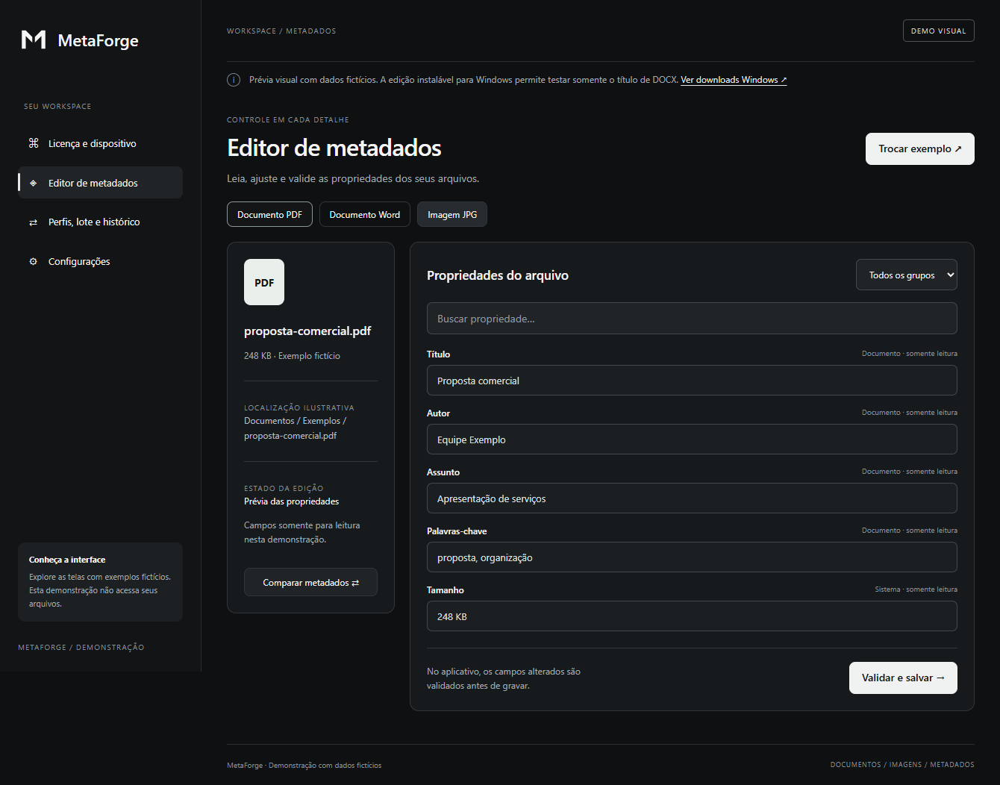

# MetaForge — demonstração pública

**Teste a alteração do título de um documento Word, preservando o original. Agora para Windows e macOS.**

O MetaForge completo edita, organiza e confere metadados de documentos e imagens. Esta demonstração independente permite editar **somente o título de DOCX** e salvar uma **nova cópia**. Autor, assunto, corpo do documento e demais partes permanecem preservados. Outros recursos são prévias bloqueadas.

Este repositório contém apenas a vitrine web e a documentação pública. Os aplicativos são distribuídos em Releases. Não inclui fontes C#/Swift, motor de produção, painel administrativo, API, banco de dados, chaves ou serviços de licenciamento. A edição completa privada do proprietário **gbr.m.s** não faz parte destes downloads.

## Downloads — versão 1.1.0

| Acesso | Link |
| --- | --- |
| Windows x64 — portátil, runtime incluído | [MetaForge-Demo-win-x64.zip](https://github.com/gsantanaoffsec/metaforge-test-version/releases/download/demo-v1.1.0/MetaForge-Demo-win-x64.zip) |
| macOS Apple Silicon — aplicativo, runtime incluído | [MetaForge-Demo-macos-arm64.zip](https://github.com/gsantanaoffsec/metaforge-test-version/releases/download/demo-v1.1.0/MetaForge-Demo-macos-arm64.zip) |
| Notas e todos os arquivos | [Release 1.1.0](https://github.com/gsantanaoffsec/metaforge-test-version/releases/tag/demo-v1.1.0) |
| Conferir downloads | [SHA256SUMS.txt](https://github.com/gsantanaoffsec/metaforge-test-version/releases/download/demo-v1.1.0/SHA256SUMS.txt) |
| Conhecer no navegador | [Vitrine web](https://gsantanaoffsec.github.io/metaforge-test-version/) |
| Cobertura e pendências de validação | [VALIDACAO.md](VALIDACAO.md) |

Não é necessário instalar .NET, criar conta, obter uma chave ou configurar um servidor. Os documentos são processados localmente. A demonstração não possui telemetria própria, coleta de HWID ou conexão com a API comercial. Os links da vitrine levam ao GitHub.

## O que mudou em 1.1.0

- Novo aplicativo macOS para Apple Silicon (M1 ou posterior).
- Demo Windows recompilada como edição **portátil**: extrair e abrir, sem instalação ou atalhos.
- Editor independente compartilhado pelas duas plataformas, limitado ao título DOCX, com verificação das partes preservadas antes da publicação.
- Revisão do título antes de salvar, confirmação de descarte e bloqueio de fechamento durante a operação.
- Vitrine, documentação e downloads atualizados para os dois sistemas.

Os fontes privados antigos da demo 1.0.0 não estavam no clone público. A versão 1.1.0 foi reconstruída como uma demo reduzida independente; ela não contém o motor completo. A aparência dos aplicativos foi ajustada. O Windows 1.0.0 continua disponível na [release anterior](https://github.com/gsantanaoffsec/metaforge-test-version/releases/tag/demo-v1.0.0).

## Testar um documento real

1. Extraia **todos os arquivos** do ZIP. Não execute dentro do arquivo compactado.
2. Windows: abra `MetaForgeDemo.exe`. macOS: abra `MetaForge Demo.app`; pode arrastá-lo para Aplicativos.
3. Clique em **Abrir DOCX** e escolha um documento de teste.
4. Altere **Título**, o único campo editável. Autor e assunto aparecem somente para leitura.
5. Clique em **Revisar e salvar nova cópia**, confira o novo título e confirme.
6. Escolha um **nome novo**, com extensão `.docx`. Destinos existentes são recusados.
7. Abra a cópia novamente na demo ou consulte suas propriedades no Word.

O título alterado é a **propriedade de metadados**. Não é o título no corpo do documento, cabeçalho da página ou nome do arquivo. Nenhuma edição de autor, assunto, datas, GPS, conteúdo, PDF, imagem ou TXT está disponível.

Atalhos: **Ctrl+O/Ctrl+S** no Windows; **⌘O/⌘S** no macOS. Os campos pendentes permanecem ao navegar entre as seções. Abrir outro arquivo ou fechar com alteração pendente pede confirmação.

## Plataformas e instalação

### Windows

Windows x64 com interface gráfica, permissão para executar aplicativos e criar arquivos. Reserve **500 MB**, além dos documentos. O runtime .NET/WPF está incluído no pacote.

A versão 1.1.0 é portátil. Não grava em `%LOCALAPPDATA%`, não cria atalhos, serviços ou registro de instalação. Mantenha **todos os arquivos e subpastas** juntos. Não substitua a pasta da edição completa.

Se usou a demo 1.0.0 instalada, pode removê-la por **Configurações → Desinstalar esta demonstração** naquela versão. A nova edição funciona separadamente.

O executável não possui certificado Authenticode comercial. O Windows pode indicar publicador desconhecido; políticas locais podem impedir a execução. Os hashes conferem o conteúdo e não substituem a assinatura do publicador.

**A compilação Windows foi concluída no macOS. A execução da interface 1.1.0 e os testes em Windows limpo ainda não foram realizados.** Não são reaproveitados como evidência os testes da interface antiga.

### macOS

Apple Silicon (M1 ou posterior). O pacote tem alvo mínimo **macOS 14**, mas foi executado somente no Mac ARM64/macOS 27 disponível nesta entrega. Intel e outras versões do macOS ainda não foram validados.

Extraia o ZIP e abra o aplicativo, ou arraste-o para Aplicativos. Não exige .NET externo. Reserve **250 MB**, além dos documentos.

O aplicativo tem assinatura local **ad hoc**, sem Developer ID e sem notarização Apple. O Gatekeeper pode impedir a abertura de um download. Use os controles normais de abertura/privacidade do macOS quando disponíveis e respeite as políticas do computador. Não é necessário desativar proteções do sistema. A assinatura local não identifica um publicador certificado.

## Recursos disponíveis e bloqueados

| Recurso | Vitrine web | Aplicativos Windows/macOS |
| --- | --- | --- |
| Navegar pelas quatro seções | Disponível | Disponível |
| Abrir DOCX real, ler título, autor e assunto | Indisponível | Disponível |
| Editar somente o título e salvar nova cópia | Indisponível | Disponível |
| Sobrescrever original ou destino existente | Indisponível | Bloqueado |
| Editar outros campos, PDF, imagens ou TXT | Indisponível | Bloqueado |
| Perfis, lote, políticas, inventário, normalização, comparação, renomeação, filas e histórico | Prévias fictícias | Bloqueados; descrições ilustrativas |
| Ativação, coleta de HWID e painel administrativo | Não incluídos | Não incluídos |

A vitrine usa dados fictícios, não acessa arquivos e não executa operações. Estados de suas prévias são ilustrações. A aparência dela pode diferir dos aplicativos reduzidos.



## Limites e problemas comuns

- DOCX de até **32 MB**, título de até **512 caracteres**.
- Exige estrutura Word e `docProps/core.xml` existentes; não cria um pacote Word ausente.
- Recusa assinaturas digitais, links de arquivo, entradas duplicadas/incompatíveis, macros e conteúdo descompactado acima dos limites.
- Confere o hash da origem antes da gravação e antes de publicar; recusa um documento alterado desde a abertura.
- Confere o título, os demais metadados e o conteúdo descompactado de todas as outras partes antes de publicar a cópia.
- A verificação é estrutural, sem renderização no Word. Não é um sanitizador nem uma ferramenta de remoção segura de informações.
- As datas/compressão do arquivo ZIP podem mudar; os bytes do DOCX resultante não são idênticos ao original.

| Situação | Como proceder |
| --- | --- |
| Salvar desativado | Abra um DOCX e altere seu título. Após salvar, altere novamente ou abra a cópia. |
| O destino já existe | Escolha outro nome. A demo não substitui arquivos. |
| O arquivo original mudou | Abra o documento novamente antes de repetir. |
| Arquivo sem propriedades básicas ou incompatível | Use um documento DOCX salvo pelo Word, sem assinatura ou macros. |
| Falha de permissão | Escolha uma pasta onde possa criar arquivos. |
| Outro recurso bloqueado | É esperado: somente título DOCX está liberado. |

## Remover a versão 1.1.0

Feche o aplicativo e apague a pasta extraída ou `MetaForge Demo.app`. Não há serviços, licenças ou dados de conta para remover. Preserve seus documentos e cópias salvas. A edição completa e a demo antiga são independentes.

## Conferir os arquivos e componentes

O pacote Windows contém o executável, bibliotecas e runtime .NET/WPF, termos, instruções e avisos de terceiros em `licenses/`. O pacote macOS contém o aplicativo AppKit/WebKit, backend e runtime .NET, interface local, ícone e avisos. Não há ExifTool, motor completo, fontes C#/Swift, PDB, mapas, banco, chave privada ou configuração comercial.

PowerShell:

```powershell
Get-FileHash .\MetaForge-Demo-win-x64.zip -Algorithm SHA256
```

macOS:

```sh
shasum -a 256 MetaForge-Demo-macos-arm64.zip
```

Compare com `SHA256SUMS.txt` da release. Consulte os [termos de uso](TERMOS-DE-USO.md).

## Manutenção da publicação

A vitrine é publicada em GitHub Pages pela branch `main`, pasta `/docs`. Este repositório público não recupera os fontes privados dos aplicativos. Fontes, scripts de build e evidências da demo são mantidos no projeto privado, sem dependência do motor completo. Não envie fontes privados, certificados, bancos, dados, logs ou o projeto principal para este repositório.

Os ZIPs e checksums são anexados a Releases, sem binários no histórico Git. Cada versão preserva seus downloads anteriores. As validações e pendências atuais estão em [VALIDACAO.md](VALIDACAO.md).
